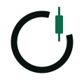

<p align="center">
  <picture>
    <source media="(prefers-color-scheme: dark)" srcset="brand/simbolo.svg">
    
  </picture>
</p>

<h1 align="center">ZenTrade</h1>

<p align="center"><b>Um robô de trading que espera o momento certo.</b><br>
Regras decidem. A IA argumenta. O risco tem a palavra final.</p>

<p align="center">
  <a href="LICENSE"></a>
  
  
</p>

---

> **Em construção.** Hoje o repositório tem a fundação e o núcleo de regras testado. Nada aqui opera dinheiro real ainda — e, quando operar, será só depois de você ligar isso de propósito.

## O que é

O ZenTrade observa o mercado de cripto, segue as estratégias que você monta e, quando uma delas dá sinal, chama um agente de IA para analisar o momento: casos parecidos no histórico, notícias recentes, regras da corretora. O agente devolve uma proposta com raciocínio e fontes. Um **motor de risco determinístico** — código simples, testado, sem IA — aprova ou barra. Só então a ordem sai.

Se a IA errar, alucinar ou sair do ar, o pior que acontece é **não operar**.

## Princípios

- **Dinheiro é decimal exato.** Nunca ponto flutuante.
- **A posição é derivada** das execuções confirmadas pela corretora, nunca gravada em dobro.
- **Toda compra tem stop**, e o alvo cobre as duas taxas.
- **Toda decisão explica o porquê**, com as fontes, e guarda o desfecho.
- **Dinheiro real por último**: robô novo nasce observando, na testnet ou em papel.

## Estrutura

```
apps/        serviços (api, motor, agente, web) — em construção
packages/
  dominio/   regras puras: dinheiro exato, indicadores, árvore de regras,
             risco, dimensionamento (busca binária) e posição
brand/       símbolo e guia da marca
```

## Para desenvolver

Requer Node 24 e Docker.

```bash
corepack pnpm install
corepack pnpm check
```

## Aviso

Software de apoio à decisão. Operar criptomoedas envolve risco de perda, inclusive total. Nada neste projeto é recomendação de investimento nem promessa de lucro.

## Licença

[AGPL-3.0](LICENSE). Contribuições seguem o [acordo de contribuição](CLA.md); veja [CONTRIBUTING.md](CONTRIBUTING.md) e [SECURITY.md](SECURITY.md).
