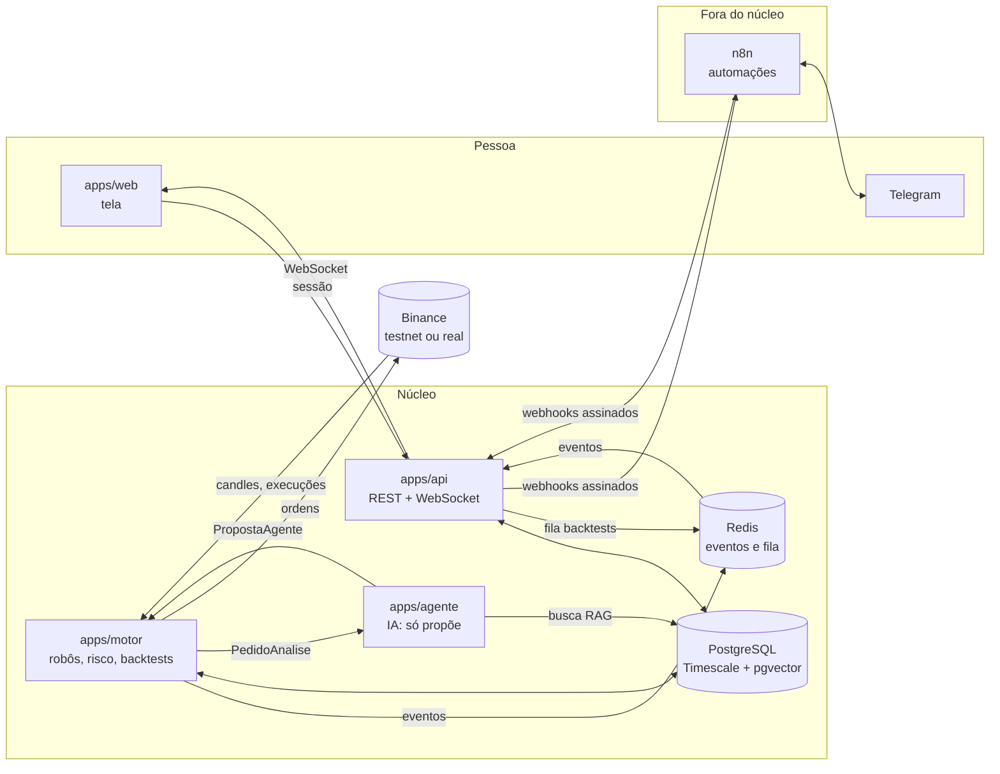

# Arquitetura

O ZenTrade é um robô de trading de cripto que separa três papéis: **regras decidem** quando há sinal, **a IA argumenta** se vale a pena e **o motor de risco**, determinístico, tem a palavra final. A IA nunca envia ordem.

Este documento dá a visão geral. Os formatos exatos estão em [`packages/contratos`](../packages/contratos/src) e as rotas em [contrato-api.md](contrato-api.md). As decisões de fundo estão nos [ADRs](adr/).

## Visão geral



## Serviços

| Serviço              | Papel                                                                                                         | Fala com                        |
| -------------------- | ------------------------------------------------------------------------------------------------------------- | ------------------------------- |
| `apps/api`           | Porta de entrada: REST e WebSocket para a tela, CLI e MCP; recebe os webhooks do n8n.                         | banco, Redis, n8n               |
| `apps/motor`         | Roda os robôs ao vivo, aplica o motor de risco, envia ordens, roda backtests da fila e publica eventos.       | banco, Redis, agente, corretora |
| `apps/agente`        | IA. Recebe um `PedidoAnalise`, consulta o histórico (RAG) e devolve uma `PropostaAgente`. Só rede interna.    | banco (leitura do RAG)          |
| `apps/web`           | Interface: construtor de estratégias, robôs, decisões, backtests, parada total.                               | API                             |
| `packages/dominio`   | Regras puras: dinheiro exato, indicadores, árvore de regras, risco, dimensionamento, posição. Sem rede.       | ninguém (é biblioteca)          |
| `packages/contratos` | Esquemas Zod dos dados que trafegam, portas de repositório, interface da corretora e assinatura dos webhooks. | ninguém (é biblioteca)          |
| PostgreSQL           | Fonte da verdade: decisões, ordens, execuções, candles (Timescale) e trechos do RAG (pgvector).               | —                               |
| Redis                | Canal de eventos `zentrade:eventos` e fila BullMQ `backtests`.                                                | —                               |
| n8n                  | Automações fora do núcleo: notícias, aprovação pelo Telegram, alertas, relatório, vigia de saúde.             | API, Telegram, feeds            |

## Fluxo de uma decisão

```mermaid
sequenceDiagram
  autonumber
  participant C as Corretora
  participant M as Motor
  participant A as Agente (IA)
  participant R as Motor de risco
  participant B as Banco
  participant N as n8n / Telegram

  C->>M: candle fechado
  M->>M: estratégia avalia a árvore de regras
  alt sem sinal
    M-->>B: nada a registrar
  else sinal COMPRAR ou VENDER
    M->>A: PedidoAnalise (sinal, preço, histórico, posição)
    A-->>M: PropostaAgente (ação, confiança, stop, alvo, fontes)
    Note over A,M: falha ou timeout de 60 s = não operar
    M->>M: dimensionamento (busca binária pelo maior lote que cabe no risco)
    M->>R: proposta de ordem + estado do robô
    R-->>M: aprovada ou barreiras (com o motivo)
    M->>B: grava a decisão com o porquê
    alt modo observar
      Note over M: só registra
    else modo sugerir
      M->>N: PropostaCriada (pela API, assinada)
      N-->>M: RespostaAprovacao (pela API) em até 5 min, ou a decisão expira
    else modo auto
      M->>C: ordem a mercado com idCliente (idempotente)
      C-->>M: execuções confirmadas
      M->>B: grava ordem e execuções; a posição é derivada delas
    end
  end
```

Pontos que valem em todos os caminhos:

- **O risco roda depois da IA e antes de qualquer ordem.** Ele lê a parada total a cada decisão, sem cache. A parada total barra entradas e saídas pela regra; stop e alvo saem sempre.
- **O stop e o alvo ficam no livro da corretora** depois da compra (`protecoes_corretora`); o motor confere a cada candle, troca quando o stop efetivo muda e tira antes de vender por conta própria.
- **A ordem é reservada no banco antes de sair** (`PortaOrdens.reservar`). Se o processo cair no meio, o `idCliente` impede ordem duplicada.
- **A posição nunca é gravada**: é recalculada a partir das execuções confirmadas pela corretora.
- **Toda decisão guarda o porquê**: a explicação da regra, a proposta da IA com as fontes, as barreiras do risco e, depois, o desfecho.

## Princípios

1. **A IA propõe, o risco decide** ([ADR 001](adr/001-ia-propoe-risco-decide.md)). Se a IA errar ou sair do ar, o pior caso é não operar.
2. **Dinheiro em decimal exato** ([ADR 002](adr/002-dinheiro-decimal-exato.md)). Indicadores podem usar `number`; preço de ordem, quantidade e resultado, nunca.
3. **Posição derivada das execuções** ([ADR 003](adr/003-posicao-derivada-das-execucoes.md)). Uma fonte da verdade, nada gravado em dobro.
4. **Toda compra tem stop e o alvo cobre as duas taxas.** O motor de risco barra o que não cumpre.
5. **A proteção sai sempre e fica na corretora** ([ADR 007](adr/007-protecao-sai-sempre.md)). Pausa, parada total e frequência barram entradas, nunca o stop; o stop e o alvo ficam no livro da corretora (OCO) e o robô vigia como segunda linha.
6. **Dinheiro real por último.** Robô novo nasce em `observar`; a rede padrão é a testnet.
7. **Automação fora do núcleo** ([ADR 006](adr/006-n8n-fora-do-nucleo.md)). O n8n avisa e pede aprovação; não decide nem envia ordem.
8. **Código aberto com proteção** ([ADR 004](adr/004-agpl-com-cla.md)) e **um banco só** para dados, séries temporais e busca vetorial ([ADR 005](adr/005-postgresql-timescale-pgvector.md)).

## Onde está cada coisa

```
apps/            serviços (api, motor, agente, web)
packages/
  dominio/       regras puras e testadas
  contratos/     formatos entre os serviços (e o subcaminho /esquemas para a tela)
  corretora/     Binance (REST e WebSocket) e corretora de papel
  banco/         esquema, migrações, RLS e repositórios sobre PostgreSQL
  conhecimento/  RAG: divisor, embeddings (Voyage ou Ollama), ingestão e busca híbrida
infra/
  docker/        Dockerfiles por serviço e o nginx da tela
  docker-compose.yml  infra de desenvolvimento e o perfil "app" (tudo junto)
  n8n/           fluxos do n8n versionados
  teste/         banco e Redis descartáveis para os testes de integração
tools/           ferramentas de desenvolvimento (ex.: validação dos fluxos)
docs/            esta documentação
```
