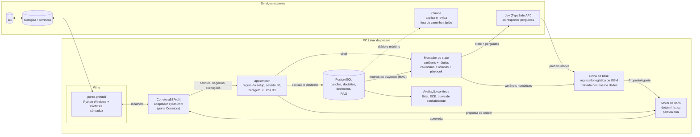

# Mini índice (WIN) e Jev: o que dá para fazer, o que não dá e como testar

Este estudo responde a uma ideia do dono do projeto: usar o ZenTrade para operar **mini índice (WIN)** em "jogada rápida" (day trade de poucos minutos) e usar o **Jev**, um modelo de IA rápido, para tomar essas decisões. A pergunta é se isso é realista, o que precisaria ser construído e como saber se dá para confiar.

> **Aviso.** Pesquisa feita em outubro de 2026. Não é recomendação de investimento, nem parecer jurídico, nem parecer tributário. Day trade de mini índice envolve risco de perda maior que o capital alocado. Resultado passado não garante resultado futuro.
>
> **Como ler as fontes.** Cada fonte citada foi aberta durante a pesquisa, salvo as marcadas com **(só busca)**: essas apareceram apenas no resumo de um buscador e precisam ser conferidas antes de virarem decisão. Onde a informação é incerta, o texto diz.

## Resumo

- **O WIN é barato de operar por contrato, mas a margem de erro é pequena.** Um ponto vale R$ 0,20 e o tick é de 5 pontos (R$ 1,00). As tarifas da B3 para quem faz pouco volume ficam perto de R$ 0,25 por contrato em cada execução. Com um tick de slippage na entrada e outro na saída, uma ida e volta custa cerca de 12 a 13 pontos. Num alvo de 50 pontos, um quarto do ganho some em custo.
- **A evidência sobre day trade de WIN é dura.** 97% das pessoas que fizeram day trade de mini índice por mais de 300 pregões perderam dinheiro, e não houve sinal de aprendizado ([Chague, De-Losso e Giovannetti](https://ideas.repec.org/p/spa/wpaper/2019wpecon47.html)).
- **O caminho técnico recomendado é a ProfitDLL rodando no Wine**, num processo separado que conversa com o ZenTrade por rede local, atrás da porta `Corretora` que já existe. É o único caminho com instrução oficial do fornecedor para Linux. O MetaTrader 5 é a alternativa. Os dois exigem confirmar preço e comportamento das ordens stop com a corretora.
- **O Jev é um classificador rápido, não um oráculo.** Ele responde perguntas fechadas sobre um `state` montado a cada chamada, com probabilidades. Não aprende com a sua conta, não faz conta direito, trata datas como texto e foi treinado com dados sintéticos. A calibração que ele promete é a do treino dele, não a do mercado.
- **Onde o Jev pode ajudar:** classificar o regime do pregão, marcar condições anormais, triar notícias e servir de filtro de sinais. Mesmo nesses papéis, ele só entra se vencer, fora da amostra, um modelo clássico simples treinado com os nossos dados.
- **"IA em que eu possa confiar" tem que virar número:** erro de calibração medido fora da amostra, limites determinísticos que a IA não toca, parada total, período em papel e um piloto pequeno com critérios de desligamento escritos antes.

## (a) O mini índice na prática

### Especificação do contrato

| Item                   | Valor                                                                                         | Fonte                                                                                                                                                                          |
| ---------------------- | --------------------------------------------------------------------------------------------- | ------------------------------------------------------------------------------------------------------------------------------------------------------------------------------ |
| Código                 | `WIN` + letra do mês + ano com dois dígitos (ex.: `WINZ26`)                                   | [B3, Futuro Mini de Ibovespa](https://www.b3.com.br/pt_br/produtos-e-servicos/negociacao/renda-variavel/futuro-mini-de-ibovespa.htm)                                           |
| Objeto                 | Ibovespa, cotado em pontos                                                                    | idem                                                                                                                                                                           |
| Valor do ponto         | R$ 0,20 por ponto                                                                             | idem                                                                                                                                                                           |
| Variação mínima (tick) | 5 pontos, ou seja, R$ 1,00 por contrato                                                       | idem                                                                                                                                                                           |
| Lote                   | 1 contrato                                                                                    | idem                                                                                                                                                                           |
| Meses de vencimento    | Meses pares: G (fev), J (abr), M (jun), Q (ago), V (out), Z (dez)                             | idem; letras dos meses (só busca, padrão usado pela B3)                                                                                                                        |
| Vencimento             | Quarta-feira mais próxima do dia 15 do mês de vencimento; é também o último dia de negociação | idem                                                                                                                                                                           |
| Liquidação             | Financeira                                                                                    | idem                                                                                                                                                                           |
| Limite de oscilação    | 10% sobre o preço de ajuste do dia anterior                                                   | [B3, Oscilação diária de negociação (nov/2025)](https://www.b3.com.br/data/files/57/31/0B/84/577BA9105B12E5A9AC094EA8/Oscilacao%20Maxima%20Diaria%20-%20PT%20-%2021112025.pdf) |
| Rolagem                | Instrumento próprio, `WI1`, com horário diferente do `WIN`                                    | [B3, horários de índices](https://www.b3.com.br/pt_br/solucoes/plataformas/puma-trading-system/para-participantes-e-traders/horario-de-negociacao/derivativos/indices/)        |

**Exemplo de calendário.** O `WINV26` venceu em 14/10/2026 (o dia 15 caiu numa quinta). Em 17/10/2026, o contrato com liquidez é o `WINZ26`, que vence em 16/12/2026 (o dia 15 cai numa terça). Feriados mudam a data; o calendário oficial de vencimentos da B3 é a referência.

**O que isso muda no ZenTrade.** O robô precisa saber qual contrato está vigente e trocar de ticker na virada. A ProfitDLL, por exemplo, não aceita códigos genéricos como `WINFUT` no envio de ordens; exige o código exato do contrato ([Nelogica, envio de ordens com a ProfitDLL](https://blog.nelogica.com.br/como-enviar-ordens-profitdll/)). Para o backtest, é preciso montar uma série contínua com regra de emenda explícita (por exemplo, trocar de contrato N pregões antes do vencimento), senão aparecem saltos falsos na data da troca.

### Horários e leilões

- Desde 9/3/2026, o mercado de derivativos funciona das 9h00 às 18h30, ajustado ao horário de verão dos Estados Unidos e da Europa ([Bora Investir/B3](https://borainvestir.b3.com.br/noticias/mercado/b3-a-bolsa-do-brasil-muda-horarios-de-negociacao-a-partir-de-9-de-marco-confira/)).
- Na grade de índices da B3 consultada em outubro de 2026, o `WIN` tem pré-abertura 5 minutos antes das 9h00, negociação até 18h25 e call eletrônico de fechamento às 18h25. A janela do preço de ajuste é das 17h00 às 17h15. No dia do vencimento, a negociação do contrato que vence encerra às 17h00 ([B3, horários de índices](https://www.b3.com.br/pt_br/solucoes/plataformas/puma-trading-system/para-participantes-e-traders/horario-de-negociacao/derivativos/indices/)).
- **After-market:** a grade consultada não mostra sessão estendida para o `WIN`. Só o `WI1` (rolagem) tem sessão estendida e after-hours. Textos de corretoras citam "after do mini índice até 19h" (só busca), mas não achamos isso na página da B3. **Trate como não confirmado.**
- A B3 costuma mudar a grade quando o horário de verão americano começa e quando termina. O próximo fim é em novembro de 2026; confira o ofício circular vigente antes de fixar horários no robô.

**Leilões, túneis e circuit breaker (o que importa para um robô):**

- **Túnel de rejeição:** a B3 recusa a oferta que chega com preço fora de uma faixa dinâmica em torno do preço de referência. **Túnel de leilão:** se um negócio for fechar fora da faixa, o sistema abre um leilão automático em vez de executar. **Túnel de proteção:** prorroga o fim de um leilão quando o preço teórico sai da faixa ([B3, metodologia dos túneis de negociação](https://www.b3.com.br/data/files/B7/04/ED/E1/87A7061099BE5706790D8AA8/Metodologia-de-Calculo-de-Tuneis-de-Negociacao.pdf)). Na prática: uma ordem a mercado ou stop pode ser recusada ou ficar presa num leilão justamente no momento de pânico. O robô precisa tratar "ordem rejeitada" e "instrumento em leilão" como estados normais, não como exceção rara.
- **Circuit breaker:** queda de 10% do Ibovespa suspende a negociação por 30 minutos; 15%, por 1 hora; 20%, por prazo definido pela B3 ([Bora Investir/B3](https://borainvestir.b3.com.br/noticias/mercado/entenda-o-que-e-e-como-funciona-o-circuit-breaker/)). Nesse intervalo, o stop não executa. Posição aberta durante uma parada fica exposta ao preço da reabertura.
- **Limite de oscilação** do WIN: 10% sobre o ajuste anterior (fonte na tabela acima).

### Margem e alavancagem

- **Day trade:** a B3 fixa uma margem mínima por contrato para day trade de varejo. Para o WIN, é **R$ 155,00** ([B3, margem mínima requerida](https://www.b3.com.br/pt_br/solucoes/plataformas/puma-trading-system/para-participantes-e-traders/regras-e-parametros-de-negociacao/margem-minima-requerida-e-guia-educacional-para-minicontratos/)), em vigor desde 2/2/2026 pelo Ofício Circular 059/2025 ([InfoMoney](https://www.infomoney.com.br/mercados/b3-revisa-margens-minimas-redefine-capital-exigido-no-day-trade/)). A corretora pode exigir mais que o mínimo.
- **Posição carregada para o dia seguinte:** a margem é calculada pela B3 e é muito maior. Valores de "cerca de R$ 6.600 por contrato" aparecem em textos de corretoras (só busca); o número muda com a volatilidade. O ZenTrade deve zerar tudo antes do fechamento, por regra, e não depender de ter margem para carregar.
- **O que a margem esconde:** com R$ 155 de margem, um contrato de WIN a 130.000 pontos movimenta cerca de R$ 26.000 de exposição (130.000 × 0,20). Uma variação de 1% do índice são 1.300 pontos, ou R$ 260 por contrato: mais que a margem inteira. **O tamanho da posição deve ser calculado pela perda no stop, nunca pela margem disponível.**

### Custos

**Tarifas da B3 (emolumentos + registro).** O documento de tarifação da B3 (versão 4.2, em vigor desde 8/12/2025) define ([B3, Tarifação: regras de cálculo e tabelas de preços](https://b3.com.br/data/files/9C/66/74/7E/2E40B9105B12E5A9AC094EA8/Tarifacao_V4.2_PT.pdf)):

- uma **tarifa única** por contrato da família Ibovespa, progressiva pelo volume médio diário (ADV) do mês: R$ 1,97 para ADV de 1 a 50 contratos, caindo até R$ 1,07 acima de 15.000;
- um **fator contrato** de 0,2 para o WIN;
- uma **redução para day trade**, também progressiva pelo ADV de day trade: 35% de 1 a 5 contratos, 40% de 6 a 50, 55% de 51 a 150, 70% de 151 a 1.500 e 75% acima;
- a divisão da tarifa única em 35% de emolumentos e o resto de tarifa de registro.

**Conta para quem opera pouco** (ADV abaixo de 50 e ADV de day trade abaixo de 5): 1,97 × 0,2 = R$ 0,39 por contrato; com a redução de 35%, cerca de **R$ 0,25 por contrato em cada execução**, ou R$ 0,50 por ida e volta. O material educativo da B3 cita "custo máximo de R$ 0,50" para o WIN ([Bora Investir/B3, out/2025](https://borainvestir.b3.com.br/tipos-de-investimentos/renda-variavel/day-trade/conheca-as-caracteristicas-dos-principais-produtos-de-day-trade/)), o que é coerente com essa conta. **Confira sempre com a nota de corretagem do primeiro mês.**

**Corretora.** Muitas corretoras zeram a corretagem de minicontratos, mas cobram plataforma, dados ou exigem contrapartidas. Exemplo: a Nova Futura oferece o Profit sem mensalidade para quem mantém o RLP ativo e opera um mínimo de contratos no ciclo; o Profit Ultra custa R$ 350/mês fixo ([Nova Futura, Profit](https://www.novafutura.com.br/profit)). **RLP** (Retail Liquidity Provider) significa que a própria corretora pode ser a contraparte das suas ordens; vale entender isso antes de automatizar. Sobre corretagem, quando houver, incide ISS municipal.

**Custo total de uma operação, com hipóteses explícitas:**

| Componente                                                      | Por contrato, ida e volta | Em pontos |
| --------------------------------------------------------------- | ------------------------- | --------- |
| Tarifas B3 (2 × R$ 0,25)                                        | R$ 0,50                   | 2,5       |
| Slippage, 1 tick na entrada e 1 na saída                        | R$ 2,00                   | 10        |
| **Total, em condição normal**                                   | **R$ 2,50**               | **12,5**  |
| Slippage na abertura ou em notícia (hipótese: 3 ticks por lado) | R$ 6,50                   | 32,5      |

O slippage é uma **hipótese a medir**, não um dado publicado: não achamos fonte primária com números de slippage do WIN. O próprio ZenTrade deve medir, na fase de papel, a diferença entre o preço do sinal e o preço executado, separando abertura (9h00 a 9h15), notícias agendadas e o resto do pregão.

### Impostos (não é parecer tributário)

- **Alíquota:** 20% sobre o ganho líquido mensal em day trade ([Receita Federal, cálculo e pagamento](https://www.gov.br/receitafederal/pt-br/assuntos/meu-imposto-de-renda/pagamento/renda-variavel/bolsa-de-valores-1/calculo-e-pagamento-do-imposto)).
- **IRRF ("dedo-duro"):** 1% sobre o resultado líquido positivo do dia, retido pela instituição. Pode ser abatido do imposto do mês ou dos meses seguintes, **só até dezembro do mesmo ano**; o que sobrar pode ser pedido em restituição na declaração ([Receita Federal, retenções](https://www.gov.br/receitafederal/pt-br/assuntos/meu-imposto-de-renda/pagamento/renda-variavel/bolsa-de-valores-1/retencoes)).
- **Pagamento:** DARF código **6015**, até o último dia útil do mês seguinte ao ganho (Receita Federal, cálculo e pagamento).
- **Prejuízo:** perda em day trade só compensa ganho em day trade, nos meses seguintes, sem prazo; não se mistura com operações comuns (IN RFB 1.585/2015, arts. 64 e 65, **só busca**: [Imprensa Nacional](https://www.in.gov.br/materia/-/asset_publisher/Kujrw0TZC2Mb/content/id/32827203/do1-2015-09-02-instrucao-normativa-n-1-585-de-31-de-agosto-de-2015-32827199)).
- **Mudança que não aconteceu:** a MP 1.303/2025 propunha 17,5% com apuração trimestral, mas caducou em 8/10/2025. A regra de 20% segue valendo em 2026 ([InfoMoney](https://www.infomoney.com.br/minhas-financas/mp-1-303-cai-no-congresso-veja-como-fica-a-tributacao-dos-investimentos-agora/)).
- **Efeito prático:** o imposto incide sobre o ganho de cada mês, mas a perda só abate ganhos futuros. Uma estratégia que alterna meses bons e ruins paga imposto nos bons antes de recuperar os ruins. O relatório do ZenTrade deve mostrar resultado antes e depois do IR estimado.

### Dados de mercado

A Política Comercial de Market Data da B3 para 2026 cobra, por mês e por conjunto de dados ([B3, Política Comercial de Market Data 2026](https://www.b3.com.br/data/files/94/95/30/28/F54599100A29E189AC094EA8/Politica%20Comercial%20de%20Market%20Data_2026.pdf)):

- **terminal não profissional** (pessoa física que usa os dados só para si), livro completo: R$ 1,86;
- **aplicação non-display para fins de trading** fora do co-location: R$ 500,00;
- dados com **atraso** são outra categoria de licença, para distribuidores.

**Ponto em aberto:** um robô pessoal que lê dados pela ProfitDLL ou pelo MetaTrader conta como "terminal não profissional" (coberto pela plataforma) ou como "aplicação non-display" (R$ 500/mês)? A política não responde isso para pessoa física, e a definição detalhada fica em outro documento da B3. **Pergunte por escrito à Nelogica ou à corretora antes de contratar.**

Para backtest, dados atrasados ou históricos bastam. Para operar, é preciso tempo real, e o robô deve parar de abrir posição se o último negócio recebido tiver mais de alguns segundos.

### Slippage na abertura e em notícias

Sem fonte primária com números, ficam os mecanismos documentados:

- a abertura e o fechamento são **leilões** (call); ordem enviada nesse período entra no leilão e sai a preço único;
- logo depois da abertura e em divulgações agendadas (Copom, IPCA, payroll americano), o livro fica raso e os túneis de leilão disparam com mais frequência;
- ordens stop viram ordens a mercado ou limitadas no disparo; num salto de preço, executam longe do preço do stop, ou não executam (stop limitado que fica para trás).

Regra prática para o robô: **não abrir posição nos primeiros minutos do pregão nem numa janela antes e depois de evento de alta importância**, e medir isso em vez de supor.

## (b) Como pessoas físicas automatizam o WIN

### Opções comparadas

| Caminho                                            | Custo                                                                                                                                                                                                                                                                                  | Linux                                                                                                                                                                                                                                                                                                                                                                  | Latência (ordem de grandeza)                                                       | Tipos de ordem                                                                                                                                                                                                                                                               | Simulador                                                                                                   | Como o ZenTrade se conectaria                                                                                                                    |
| -------------------------------------------------- | -------------------------------------------------------------------------------------------------------------------------------------------------------------------------------------------------------------------------------------------------------------------------------------- | ---------------------------------------------------------------------------------------------------------------------------------------------------------------------------------------------------------------------------------------------------------------------------------------------------------------------------------------------------------------------- | ---------------------------------------------------------------------------------- | ---------------------------------------------------------------------------------------------------------------------------------------------------------------------------------------------------------------------------------------------------------------------------- | ----------------------------------------------------------------------------------------------------------- | ------------------------------------------------------------------------------------------------------------------------------------------------ |
| **Profit + NTSL** (automação dentro do Profit)     | Profit Pro ou Ultra; módulo de automação gratuito em conta de simulação e pago em conta real, a partir de cerca de R$ 100/mês (**só busca**: [Nelogica, ajuda](https://ajuda.nelogica.com.br/hc/pt-br/articles/8865257831195-Como-utilizar-a-Automa%C3%A7%C3%A3o-de-Estrat%C3%A9gias)) | Profit nativo para Linux desde agosto de 2026 (Ubuntu 18.04+, Debian 10+, Fedora 32+); versões white label de corretoras ainda não ([Nelogica](https://blog.nelogica.com.br/profit-linux/))                                                                                                                                                                            | Baixa (roda dentro da plataforma)                                                  | Mercado, limitada, stop, OCO, stop móvel (na plataforma)                                                                                                                                                                                                                     | Sim, conta de simulação                                                                                     | **Não se conecta.** A estratégia vive dentro do Profit, em NTSL. Não dá para chamar o motor de risco, o RAG nem o Jev. Serve só como comparação. |
| **ProfitDLL** (biblioteca para programas externos) | Licença paga; preço não publicado na página que conseguimos abrir (**pergunta em aberto**)                                                                                                                                                                                             | Sem versão nativa. A Nelogica publicou o passo a passo para rodar o Python para Windows dentro do Wine e carregar a DLL ([Nelogica, ProfitDLL no Linux](https://blog.nelogica.com.br/profitdll-linux/))                                                                                                                                                                | Baixa a média: chamada local na DLL, ida até o servidor da Nelogica e da corretora | Market, Limit, StopLimit; cancelar, alterar, zerar posição ([Nelogica, envio de ordens](https://blog.nelogica.com.br/como-enviar-ordens-profitdll/)). OCO não aparece nas funções de roteamento listadas: teria que ser emulado                                              | Depende da conta. Não confirmamos se a DLL roteia para a conta de simulação (**pergunta em aberto**)        | Processo "ponte" em Python no Wine, que expõe uma API local (HTTP ou WebSocket) para um adaptador TypeScript que implementa a porta `Corretora`. |
| **MetaTrader 5 via corretora**                     | Plataforma gratuita em várias corretoras; conta demo grátis em XP e Rico e paga na Clear segundo um blog de terceiros (**só busca**)                                                                                                                                                   | O pacote Python oficial `MetaTrader5` só tem versões para Windows x64 ([PyPI](https://pypi.org/project/MetaTrader5/)). No Linux, roda-se o terminal e o Python para Windows no Wine, com uma ponte RPC como o `pymt5linux` ([GitHub](https://github.com/hpdeandrade/pymt5linux)); o terminal precisa estar aberto ([fórum MQL5](https://www.mql5.com/en/forum/457940)) | Média: ponte RPC + terminal + servidor da corretora                                | `order_send` com mercado, limitada, stop, stop-limit; SL/TP presos à posição ([MQL5, integração Python](https://www.mql5.com/en/docs/python_metatrader5)). Onde o SL/TP fica guardado em contas da B3 (no servidor da corretora ou no livro da bolsa) **não foi confirmado** | Demo existe, mas há relatos de demos sem WIN ([fórum MQL5](https://www.mql5.com/pt/forum/305871), só busca) | Mesmo desenho: ponte Python no Wine + adaptador TypeScript.                                                                                      |
| **APIs de terceiros (Cedro)**                      | Sob consulta ([Cedro, API Trading](https://www.cedrotech.com/apis/api-trading/))                                                                                                                                                                                                       | Sem restrição: REST, WebSocket e FIX                                                                                                                                                                                                                                                                                                                                   | Média                                                                              | Envio, edição e cancelamento; stop e OCO não detalhados na página                                                                                                                                                                                                            | Não informado                                                                                               | Adaptador TypeScript direto, sem Wine. Corretoras parceiras não listadas na página.                                                              |
| **APIs da B3**                                     | —                                                                                                                                                                                                                                                                                      | —                                                                                                                                                                                                                                                                                                                                                                      | —                                                                                  | —                                                                                                                                                                                                                                                                            | —                                                                                                           | **Não serve.** A B3 não dá acesso às APIs para pessoa física; são só B2B ([B3 Developers](https://developers.b3.com.br/apis)).                   |

Não achamos API pública de negociação para pessoa física na XP ou no BTG durante esta pesquisa; isso não prova que não exista, só que não está documentada em página aberta.

### O que muda na porta `Corretora`

A porta atual (`packages/contratos/src/corretora.ts`) foi feita para o spot da Binance: compra, venda de proteção, saldo em ativo. O WIN exige:

- **lado vendido:** abrir posição vendendo e proteger com **compra** stop;
- **contrato e multiplicador:** quantidade em contratos inteiros, preço em pontos, valor do ponto (R$ 0,20) e tick (5 pontos) na especificação do ativo;
- **margem, não saldo:** `saldoLivre(ativo)` vira "margem disponível para day trade";
- **sessão:** fases do pregão (pré-abertura, contínuo, leilão, call de fechamento, fechado), para o motor não mandar ordem em leilão sem querer;
- **contrato vigente e rolagem:** o adaptador resolve `WIN` para o código do mês;
- **zeragem obrigatória:** uma rotina determinística que zera tudo X minutos antes do fim do pregão, independente da IA;
- **estados novos de ordem:** rejeitada por túnel, em leilão, suspensa (circuit breaker).

A posição continua derivada das execuções (ADR 003) e o dinheiro continua em decimal exato (ADR 002). A proteção na corretora (ADR 007) precisa de cuidado: no WIN, uma stop-limit pode ficar no servidor da plataforma ou da corretora, e não no livro da B3. Se o OCO for emulado pelo ZenTrade, uma perna pode sobrar se o processo cair entre a execução de uma e o cancelamento da outra, e isso **abre uma posição nova no sentido contrário**. Por isso, na primeira versão: **só stop, sem alvo no livro**; a saída no alvo é feita pelo motor com ordem limitada.

### Recomendação: ProfitDLL no Wine, atrás de uma ponte local

Recomendamos o caminho **ProfitDLL**, com o MetaTrader 5 como alternativa, pelos motivos abaixo:

1. **É o único com caminho oficial para Linux.** A Nelogica documentou, em agosto de 2026, como carregar a DLL num Python para Windows dentro do Wine, sem máquina virtual. No MT5, o caminho Linux é comunitário.
2. **Dados e ordens no mesmo lugar**, com histórico de negócios. O Profit nativo para Linux serve para a pessoa acompanhar na tela o que o robô faz, com a mesma conta.
3. **Não exige rodar a interface gráfica de um terminal** para o robô funcionar, como o pacote do MT5 exige.
4. **O peso é pequeno.** O que roda no PC é um processo Python e a DLL; nada de modelo local.

O que pesa contra e precisa de resposta antes de pagar:

- preço da licença da ProfitDLL e se a corretora escolhida aceita roteamento por ela;
- se a DLL roteia para a conta de simulação;
- onde fica a StopLimit (livro da B3 ou servidor);
- se o uso de dados do robô cai na tarifa non-display da B3;
- dependência de um fornecedor proprietário e do Wine (uma atualização pode quebrar).

**Desenho da ponte:** um processo `ponte-profitdll` (Python no Wine) com uma API local mínima: `assinar(ticker)`, `enviar(ordem)`, `cancelar(id)`, `ordem(id)`, `posicao()`, `estado()`. O adaptador `CorretoraB3Profit` (TypeScript, em `packages/corretora`) fala com ela por `localhost` e implementa a porta. A ponte não decide nada: só traduz. Se a ponte cair, o motor deixa de abrir posição e avisa; a stop já colocada continua onde estiver.

Se a ProfitDLL não for viável no preço, o MT5 entra no mesmo desenho, trocando só a ponte.

## (c) Regulação (não é parecer jurídico)

- **Automatizar a própria conta:** a CVM explica que o credenciamento como analista vale para serviços que oferecem estratégias prontas, **exceto sistemas que só operacionalizam decisões do próprio investidor**, sem restrição de parametrização (Ofício-Circular CVM/SIN 2/2019, resumido em [CVM, robôs de investimentos](https://www.gov.br/investidor/pt-br/investir/como-investir/profissionais-do-mercado/robos-de-investimentos)). Um ZenTrade de código aberto, configurado e rodado pela própria pessoa, é o caso mais próximo dessa exceção.
- **Oferecer a terceiros:** estratégias prontas, sinais ou "robô que opera por você" aproximam-se de análise ([Res. CVM 20](https://conteudo.cvm.gov.br/legislacao/resolucoes/resol020.html)), consultoria (Res. CVM 19) ou administração de carteira ([Res. CVM 21](https://conteudo.cvm.gov.br/legislacao/resolucoes/resol021.html)), com registro e responsabilidade de quem presta o serviço. Usar algoritmo não diminui essa responsabilidade (Res. CVM 19, art. 16, citado em [`fundamentacao.md`](fundamentacao.md)).
- **A corretora:** a B3 recomenda que a plataforma que executa as ordens do robô seja homologada pela corretora e que o robô tenha limite de perda por período ([Bora Investir/B3, robô trader](https://borainvestir.b3.com.br/noticias/robo-trader-veja-como-automatizar-os-investimentos-no-day-trade/)). Ordens por sistemas eletrônicos seguem as regras de acesso direto ao mercado (DMA), com rastreio de origem e controle de risco pré-negociação pelo intermediário (Res. CVM 35, **só busca**: [texto consolidado](https://conteudo.cvm.gov.br/export/sites/cvm/legislacao/resolucoes/anexos/001/resol035consolid.pdf)). Na prática: use uma plataforma que a corretora aceita (Profit ou MT5), leia o termo de uso de automação que ela pedir e conte com os limites de risco dela por cima dos seus.
- **Promessa de resultado:** nunca. A CVM alerta que não há evidência de lucratividade maior com robôs para pessoas físicas (página da CVM acima).

Antes de oferecer qualquer coisa a outras pessoas, consulte um advogado.

## (d) O Jev a fundo

### O que é

- Um modelo **discriminativo** da TypeSafe AI, lançado em acesso antecipado em 15/9/2026, que devolve **valores tipados com probabilidades e confiança**, não texto ([Wikipedia](<https://en.wikipedia.org/wiki/Jev_(AI_model)>); [TypeSafe, anúncio](https://typesafe.ai/blog/introducing-system-one-models-and-jev)). A empresa chama isso de "System One", em referência ao pensamento rápido de Kahneman ([docs, System One](https://docs.typesafe.ai/concepts/system-one)).
- Treinado **só com dados sintéticos**, por um método não publicado chamado RLCD (aprendizado por reforço para decisões calibradas). Arquitetura, pesos e artigo técnico não foram publicados (Wikipedia).
- **Proprietário e só por API.** Não há ajuste fino por conta: o comportamento se molda pelo `state`, pelas instruções e pelos critérios das perguntas ([docs, Models](https://docs.typesafe.ai/models)).
- A TypeSafe diz que não treina com dados de clientes; retenção zero só para clientes empresariais, sob pedido ([docs, Legal](https://docs.typesafe.ai/legal.md)).

### O que ele não é

- **Não gera texto nem explicações.** A documentação diz para não usar o Jev em tarefas de geração, código ou explicação de raciocínio (docs, System One).
- **Não é calculadora.** A própria TypeSafe lista como fraquezas do Jev 1.13: contas e contagem, comparação de datas (trata datas como texto), precisão numérica, perguntas com várias etapas, contexto grande e irrelevante (que distrai), conteúdo adversário (injeção de instruções), instruções contraditórias e viés pela ordem das opções. A recomendação é deixar a computação no código e usar o modelo só para julgamento semântico ([docs, Jev 1.13 jaggedness](https://docs.typesafe.ai/model-jaggedness/jev-1.13.md)).
- **Funciona melhor em inglês;** outras línguas são aceitas com menos precisão (docs, Models).
- **Não sabe o futuro.** Nenhum modelo sabe. O que ele pode fazer é julgar se o estado atual se parece com o que as regras descrevem.

### Formato da API

- **Endpoint:** `POST https://api.typesafe.ai/v1/systemone`, com `Authorization: Bearer <chave>` ([docs, API](https://docs.typesafe.ai/api)). SDK para TypeScript: `@typesafe-ai/sdk`, Node 22+, chave em `TYPESAFE_API_KEY` ([docs, SDK JavaScript](https://docs.typesafe.ai/sdk/javascript)). O ZenTrade usa Node 24, então serve.
- **Corpo:** `model`, `state` (texto, objeto ou lista) e `questions` (um mapa de perguntas com nome). Cada pergunta tem `type`, `instructions` e, quando cabe, `criteria`.
- **Três tipos de pergunta** ([docs, Primitives](https://docs.typesafe.ai/primitives)):
  - `noul`: sim ou não; devolve um número de 0 a 1, a probabilidade de "sim" ([docs, Noul](https://docs.typesafe.ai/primitives/noul.md));
  - `choice`: uma opção entre várias, sem ordem; devolve a escolha, a distribuição de probabilidades e a confiança;
  - `score`: um nível numa escala ordenada; devolve o nível, a legenda, as probabilidades e a confiança.
- **Perguntas independentes e em paralelo.** Todas veem o mesmo `state`; uma não pode depender da resposta da outra. Não há limite de número de perguntas, só de tamanho. Várias perguntas numa chamada saem 11,5 vezes mais baratas e 9,6 vezes mais rápidas que chamadas separadas, segundo a TypeSafe (docs, Primitives).
- **Resposta:** `model` (versão usada), `answers` (um por pergunta) e `usage` (tokens).
- **Limites:** 64 mil tokens por requisição e 32 mil para o `state` mais a pergunta mais longa; um cabeçalho de contexto longo sobe os dois para 262 mil (docs, Models). Corpo até 32 MiB, aninhamento até 64 níveis, números finitos (docs, API).
- **Erros:** 429 (limite de taxa: recuar com espera crescente) e 529 (sobrecarga), além dos de validação (docs, API). O TechCrunch relatou que a TypeSafe chegou a ficar sem capacidade de servir a API logo após o lançamento ([TechCrunch](https://techcrunch.com/2026/09/18/a-new-kind-of-ai-model-from-a-chatgpt-inventor-is-thrilling-developers/)).
- **Limites de taxa:** por organização, em tokens e requisições por segundo, vistos no console; níveis maiores via vendas (docs, Models).
- **Versões:** `jev-1.13.0` (estável, alias `jev-latest`) e `jev-1.14.0` (alias `jev-preview`). **Para decisões auditáveis, fixe a versão exata,** nunca o alias.
- **Preço:** US$ 0,042 por milhão de tokens de entrada; saída grátis (docs, Models; [The Register](https://www.theregister.com/ai-and-ml/2026/09/16/typesafe-ai-debuts-model-for-machines-that-plays-doom/5296711)). Corrigindo o que tínhamos: **o preço está publicado.** Um `state` de 5 mil tokens em 400 decisões por dia dá 2 milhões de tokens, cerca de US$ 0,08 por dia. Custo não é o problema; dependência e validação são.
- **Acesso:** chave no console da TypeSafe; o anúncio fala em tirar desenvolvedores da lista de espera "o mais rápido possível" (TypeSafe, anúncio). Não achamos documentação de cota grátis.
- **Latência:** 70 a 500 ms, segundo a TypeSafe, que admite que os testes internos podem estar "do lado alto" dos ganhos reais (TypeSafe, anúncio). Some a ida e volta do Brasil aos servidores dela, que não está documentada; **meça antes de assumir**.

### Confiança e calibração, segundo a TypeSafe

- A confiança é derivada da forma da distribuição de probabilidades, por fórmula reproduzível ([docs, Confidence](https://docs.typesafe.ai/confidence)).
- A documentação sugere faixas (acima de 0,9 age, de 0,5 a 0,9 pede confirmação, abaixo de 0,5 escala para humano) e diz que ações com consequência maior pedem limite maior ([docs, roteamento por confiança](https://docs.typesafe.ai/patterns/confidence-routing.md)).
- **A própria documentação não garante calibração no seu domínio** e manda começar conservador, testar com os próprios dados e ajustar (docs, Confidence). A calibração vale para grupos de previsões, não para cada resposta (docs, System One).
- A TypeSafe recomenda combinar as probabilidades das perguntas no código, inclusive com **modelos clássicos de aprendizado de máquina a jusante** ([docs, como construir](https://docs.typesafe.ai/concepts/how-to-build-with-system-one.md)). É exatamente o desenho proposto abaixo.
- Crítica registrada pela imprensa: o modelo "delega o problema da alucinação" para quem interpreta a confiança (Armin Ronacher, citado pelo TechCrunch).

### Onde um modelo rápido e discriminativo pode ajudar o ZenTrade

1. **Filtro de sinal (pegar ou pular).** A regra gera o sinal; o Jev recebe o estado e responde se o sinal cumpre o playbook e se há motivo para pular. A probabilidade dele vira **uma variável de entrada**, não a decisão final.
2. **Regime do pregão:** tendência, lateral, volátil sem direção, anormal. Uma estratégia de rompimento só liga em tendência; uma de reversão, só em lateral.
3. **Veto em condição anormal:** livro raso, spread alto, leilão, dado atrasado, véspera de evento. Um veto só reduz risco: no pior caso, o robô deixa de operar.
4. **Triagem de notícias para a base de conhecimento:** classificar cada notícia por relevância para o Ibovespa e tipo de evento antes de indexar. Cuidado: notícia é conteúdo de terceiros e o Jev não se defende de injeção (docs, jaggedness); a saída dele só pode virar rótulo, nunca instrução.

### Onde ele não ajuda

- **Prever o próximo movimento.** O mercado de WIN é disputado por operadores de alta frequência (HFT) com co-location; um PC doméstico com Wine e internet comum chega depois deles por definição. O estudo da FGV traz HFT entre as palavras-chave; resumos de terceiros dizem que os autores consideram "virtualmente impossível" competir com eles (só busca), mas o resumo que abrimos não detalha esse ponto.
- **Calibração sintética não é calibração de mercado.** O Jev foi otimizado contra rótulos sintéticos. Uma probabilidade de 0,8 dele significa "parecido com os exemplos sintéticos em que 'sim' era certo 80% das vezes", não "80% de chance de o alvo bater antes do stop". Só medindo com os nossos dados se sabe.
- **Latência a mais.** Um motor de regras decide em microssegundos. O Jev soma centenas de milissegundos mais a rede. Para candles de 1 a 5 minutos, isso cabe; para scalping por tick, não.
- **Dependência de fornecedor.** Modelo proprietário, em acesso antecipado, de uma empresa fundada em 2024, sem SLA público encontrado. A versão muda; o alias `jev-latest` muda junto. Se a API cair, o ZenTrade deve deixar de operar, como já faz com o Claude.
- **Números e tempo.** Tudo o que for conta (distância ao stop, horário até o evento, ATR) precisa chegar pronto e também em rótulo ("longe", "perto"), porque ele não calcula bem.

### Comparação com o que já existe e com um modelo clássico

| Critério                                 | Claude (analista atual)                                                                                                               | Jev                                                             | Modelo clássico (regressão logística ou gradient boosting) |
| ---------------------------------------- | ------------------------------------------------------------------------------------------------------------------------------------- | --------------------------------------------------------------- | ---------------------------------------------------------- |
| Latência                                 | Segundos; o agente aceita até 60 s                                                                                                    | 70 a 500 ms (declarado) + rede                                  | Microssegundos, local                                      |
| Custo por decisão                        | Centavos de dólar                                                                                                                     | Fração de centésimo de centavo                                  | Zero                                                       |
| Saída                                    | Texto estruturado, com justificativa e fontes                                                                                         | Probabilidades tipadas, sem texto                               | Uma probabilidade                                          |
| Explica a decisão                        | Sim, em linguagem                                                                                                                     | Não; só os rótulos das perguntas                                | Pesos e importância das variáveis                          |
| Aprende com os nossos dados              | Não (só RAG)                                                                                                                          | Não (só `state`)                                                | **Sim**, é treinado neles                                  |
| Auditável e reproduzível                 | Parcial                                                                                                                               | Parcial (versão fixa, modelo fechado)                           | Total                                                      |
| Risco de "lembrar o passado" no backtest | Alto: modelos de linguagem conhecem o que aconteceu depois de notícias antigas ([Glasserman e Lin](https://arxiv.org/abs/2309.17322)) | Desconhecido; treino sintético reduz, mas não há como verificar | Nenhum, se o treino respeitar o tempo                      |
| Funciona sem internet                    | Não                                                                                                                                   | Não                                                             | Sim                                                        |

Leitura: o **modelo clássico é a linha de base obrigatória.** Ele é rápido, barato, auditável e aprende com os nossos resultados. O Jev só tem lugar se, sobre as mesmas decisões, acrescentar informação que o modelo clássico não tem: julgamento sobre texto (notícias, calendário, regras do playbook escritas em linguagem). O Claude continua útil fora do caminho crítico: explicar decisões depois, revisar o diário, escrever o relatório.

### "Uma IA em que eu possa confiar para operações rápidas" é realista?

**Não, no sentido de uma IA que acerta o mercado.** Nenhuma fonte encontrada sustenta isso para varejo em WIN, e as estratégias com modelos de linguagem perdem a vantagem em testes longos ([Li et al.](https://arxiv.org/abs/2505.07078)).

**Sim, no sentido de um componente cujo erro é medido e cujo estrago é limitado.** Confiança operacional quer dizer:

1. **Calibração medida fora da amostra:** Brier score e curva de confiabilidade (reliability diagram) sobre as decisões do ZenTrade, por faixa de probabilidade ([scikit-learn, calibração](https://scikit-learn.org/stable/modules/calibration.html)). Se o Jev diz 0,7, perto de 70% daquelas decisões têm que dar certo. Se não der, recalibra-se (Platt ou isotônica) com os nossos dados, ou o Jev sai.
2. **Comparação com a linha de base:** o Jev precisa ganhar do modelo clássico, não só da moeda.
3. **Limites determinísticos que a IA não toca:** perda por operação, perda do dia, número de operações, horário, zeragem no fim do dia.
4. **Parada total** que barra entradas e deixa o stop sair.
5. **Período em papel** com os mesmos critérios, antes de dinheiro real.
6. **Critérios de desligamento escritos antes de começar.**

## (e) O que "a base de conhecimento do Jev" quer dizer

O Jev **não aprende** com documentos que se colocam numa base. Ele não tem ajuste fino por conta e não guarda memória entre chamadas (docs, Models). Tudo o que ele sabe sobre a decisão está no `state` daquela chamada.

Então, "base de conhecimento para o Jev" significa: **a cada decisão, o ZenTrade monta o `state`** juntando:

- os dados de mercado e as variáveis já calculadas pelo motor;
- o contexto da sessão (fase do pregão, minutos até o fechamento, contrato vigente);
- o calendário econômico e as notícias recentes já triadas;
- a posição e os limites de risco (só para informação; quem aplica é o motor de risco);
- **as regras do playbook** daquele setup, buscadas no RAG da pessoa (`packages/conhecimento`).

A documentação pede para juntar no `state` só o que informa a decisão e usar objetos com nomes descritivos ([docs, State](https://docs.typesafe.ai/concepts/state)); contexto irrelevante piora a resposta (docs, jaggedness). Ou seja: **buscar pouco e bem**, não despejar a base inteira.

As notas em [`conhecimento/semente/`](../conhecimento/semente/) são o ponto de partida dessa base: servem ao assistente e ao analista Claude, e os trechos de playbook delas podem entrar no `state` do Jev.

### Esquema proposto do `state` para uma decisão de WIN

Chaves em inglês porque o Jev é mais preciso em inglês (docs, Models). Vale testar a versão em português e comparar. Cada número vem acompanhado de um rótulo calculado pelo código.

```json
{
  "decision": {
    "id": "dec-2026-10-19-1042-win01",
    "local_time": "10:42",
    "session_phase": "continuous",
    "minutes_since_open": 102,
    "minutes_to_forced_flat": 448
  },
  "instrument": {
    "ticker": "WINZ26",
    "point_value_brl": "0.20",
    "tick_points": 5,
    "days_to_expiry": 58,
    "in_roll_window": false
  },
  "signal": {
    "setup_id": "opening_range_breakout",
    "side": "buy",
    "rule_explanation": "Close above the 9:00-9:30 range high with volume above the 20-bar average.",
    "stop_distance_ticks": 60,
    "target_distance_ticks": 120,
    "target_to_cost_ratio": { "value": 9.6, "label": "comfortable" }
  },
  "market": {
    "trend_15m": { "value": 0.42, "label": "up_moderate" },
    "atr_1m_vs_20d_avg": { "value": 1.3, "label": "above_usual" },
    "distance_to_vwap_ticks": { "value": 14, "label": "far_above" },
    "volume_vs_same_time_avg": { "value": 1.8, "label": "high" },
    "spread_ticks": { "value": 1, "label": "normal" },
    "top5_book_imbalance": { "value": 0.62, "label": "buy_side_heavier" },
    "opening_gap_pct": { "value": -0.6, "label": "small_gap_down" },
    "data_quality": { "last_trade_age_ms": 180, "missing_bars_today": 0, "label": "ok" }
  },
  "calendar": {
    "next_event": {
      "minutes_until": 18,
      "name": "BCB president speech",
      "importance": "high",
      "label": "event_soon"
    },
    "last_event": { "minutes_since": 95, "name": "IPCA-15", "importance": "high", "label": "settled" }
  },
  "news": [
    { "source_id": "rag:noticia:8812", "age_minutes": 12, "headline": "…", "triage": "br_macro_relevant" }
  ],
  "position": { "side": "flat", "contracts": 0 },
  "risk_context": {
    "day_result_vs_limit": { "value": -0.4, "label": "used_40pct_of_daily_loss" },
    "trades_today_vs_max": { "value": 0.5, "label": "half_used" },
    "consecutive_losses": 2
  },
  "playbook": {
    "setup_rules": ["…regras do setup buscadas no RAG…"],
    "avoid_rules": ["Do not open a position 15 minutes before or after a high-importance event."]
  }
}
```

Regras do esquema:

- **Sem dado pessoal.** Nada de nome, CPF, conta ou saldo em reais; o risco vai em proporção do limite. Isso também reduz o que sai do país pela API.
- **Notícia entra como manchete curta e rótulo**, com o id da fonte, nunca o texto inteiro.
- **Tamanho alvo:** 2 a 5 mil tokens. Bem abaixo do limite de 32 mil.
- **O que o Jev não decide:** tamanho, stop e limites. Estão no `state` só como contexto.

### Conjunto de perguntas (saídas tipadas)

| Nome           | Tipo     | Pergunta (resumo)                                                                                                              | Saída usada para                    |
| -------------- | -------- | ------------------------------------------------------------------------------------------------------------------------------ | ----------------------------------- |
| `regime`       | `choice` | Qual o regime do pregão em `market`? Opções: `trend_up`, `trend_down`, `range`, `volatile_no_direction`, `abnormal`            | Ligar ou desligar setups por regime |
| `event_window` | `choice` | Em relação a `calendar` e `news`: `clear`, `event_soon`, `event_now`, `post_event`                                             | Veto por janela de notícia          |
| `abnormal`     | `noul`   | Há condição anormal em `market.data_quality`, spread, livro ou `session_phase`?                                                | Veto                                |
| `setup_match`  | `noul`   | O sinal cumpre todas as `playbook.setup_rules` e nenhuma `avoid_rules`?                                                        | Variável do filtro                  |
| `take`         | `noul`   | Pelo playbook, este sinal deve ser aceito?                                                                                     | Variável do filtro                  |
| `conviction`   | `score`  | Quão bem o contexto apoia o sinal (5 níveis, de "contradiz" a "apoia fortemente")                                              | Variável do filtro                  |
| `skip_reason`  | `choice` | Principal motivo para pular: `none`, `regime_against`, `news`, `cost_vs_target`, `abnormal`, `risk_near_limit`, `session_time` | Registro e justificativa            |

Esboço com o SDK TypeScript. A documentação mostra `TypeSafeClient`, `systemOne` e o auxiliar `choice`; o auxiliar `noul` e o campo `model` no SDK seguem o formato da API HTTP e **precisam ser conferidos** na versão instalada. A ordem das opções deve ser embaralhada nos testes, por causa do viés de ordem:

```ts
import { TypeSafeClient, choice, noul } from "@typesafe-ai/sdk";

const jev = new TypeSafeClient(); // lê TYPESAFE_API_KEY
const r = await jev.systemOne({
  model: "jev-1.13.0", // versão fixa, nunca jev-latest (conferir o nome do campo no SDK)
  state,
  questions: {
    regime: choice("What is the intraday regime described in `market`?", {
      trend_up: null,
      trend_down: null,
      range: null,
      volatile_no_direction: null,
      abnormal: null,
    }),
    abnormal: noul(
      "Is any condition in `market.data_quality`, spread, book or `decision.session_phase` abnormal for opening a position?",
    ),
    setup_match: noul(
      "Does `signal` satisfy every rule in `playbook.setup_rules` and violate none in `playbook.avoid_rules`?",
    ),
  },
});
```

**Como a resposta vira `PropostaAgente`** (o formato que o motor já aceita, em `packages/contratos/src/proposta.ts`):

- `acao`: `aguardar` se `abnormal` > limite, `event_window` ≠ `clear` ou o filtro final ficar abaixo do limite; senão, o lado do sinal (`comprar` ou `vender`);
- `confianca`: a probabilidade **do filtro final recalibrado com os nossos dados**, não a saída crua do Jev;
- `tamanhoRelativo`: 1 ou menos (pode reduzir, nunca aumentar);
- `justificativa`: texto montado pelo código a partir dos rótulos (o Jev não escreve texto);
- `fontes`: os ids das notas do playbook e das notícias que entraram no `state`;
- timeout curto (por exemplo, 1,5 s): sem resposta, não opera.

## (f) Arquitetura proposta: ZenTrade + WIN + Jev



O ponto central do desenho: **o Jev alimenta um modelo que é nosso**, e esse modelo é que é medido e calibrado. Se o Jev não acrescentar nada, ele sai e a linha de base continua sozinha.

### Fases e critérios de avanço

Os limites abaixo são **propostas iniciais**, para serem fixados por escrito antes de cada fase começar, não depois de ver o resultado.

**Fase 1: dados e backtest do WIN com custos da B3**

- Dados: como importar o WIN (arquivos de negócios da B3 e CSV do MetaTrader 5) e a aproximação pelo Ibovespa (`WIN-IBOV`) está em [`dados-b3.md`](dados-b3.md).
- Construir: série contínua de 1 minuto (pelo menos 2 anos), regra de rolagem explícita, custos B3 pela tabela de tarifação, slippage de 1 tick por perna em stop e mercado e 3 ticks na abertura e em notícias, sessão e zeragem, IR estimado no relatório.
- Validar como em [`fundamentacao.md`](fundamentacao.md): hipótese antes dos dados, walk-forward com pelo menos 6 janelas, número de variações testadas registrado, Deflated Sharpe ([Bailey e López de Prado](https://www.davidhbailey.com/dhbpapers/deflated-sharpe.pdf)) e probabilidade de overfitting ([Bailey et al.](https://www.davidhbailey.com/dhbpapers/backtest-prob.pdf)).
- **Avança se:**
  - profit factor fora da amostra, depois de custos, ≥ 1,3;
  - pelo menos 300 operações fora da amostra;
  - Deflated Sharpe com probabilidade ≥ 0,95;
  - continua positivo com +1 tick de slippage por perna e sem o melhor mês;
  - queda máxima fora da amostra dentro do que a pessoa aceita perder, escrita antes.
- **Para se:** nada passa. É o resultado mais provável, e é um resultado útil: evita perder dinheiro.

**Fase 2: papel com dados ao vivo (conta de simulação)**

- Construir: ponte e adaptador; o robô em modo `observar` e depois `auto` na simulação.
- **Avança se:**
  - pelo menos 40 pregões;
  - slippage médio medido ≤ o assumido no backtest;
  - resultado dentro do intervalo previsto pelo backtest fora da amostra;
  - zero ordens órfãs, zeragem diária sempre executada, parada total testada em pregão;
  - reconciliação entre posição do ZenTrade e da corretora sem divergência.

**Fase 3: Jev como provedor de análise, medido contra a linha de base**

- Construir: `ProvedorJev` com a mesma interface dos provedores do Claude (`AnalistaDeUmProvedor` em `apps/agente/src/provedores`), o montador de `state` e a linha de base.
- Rodar em **sombra**: o Jev e a linha de base avaliam as mesmas decisões; nenhum dos dois manda ordem ainda.
- Rotular cada decisão com o desfecho (alvo antes do stop, stop antes do alvo, ou tempo esgotado) usando só dados posteriores à decisão.
- **Avança se:**
  - pelo menos 500 decisões rotuladas;
  - erro de calibração esperado (ECE) ≤ 0,05 depois de recalibrado, e curva de confiabilidade perto da diagonal;
  - Brier score melhor que o da linha de base, com intervalo de confiança por bootstrap que não cruze zero;
  - filtrar sinais com o Jev melhora o profit factor ou reduz a queda máxima em relação a filtrar com a linha de base;
  - latência p99 ≤ 800 ms e disponibilidade ≥ 99,5% em horário de pregão.
- **Se não passar:** o Jev fica fora; a linha de base segue sozinha (se ela própria passar).

**Fase 4: piloto pequeno com dinheiro real**

- 1 contrato. Limite de perda por operação, por dia e por mês fixos, definidos em reais pela pessoa antes de começar. Stop sempre colocado. Sem operar nos primeiros minutos do pregão nem perto de eventos de alta importância. Zeragem antes do fechamento. Aprovação humana nas primeiras semanas (modo `sugerir`).
- Duração mínima: 3 meses.
- **Desliga se:**
  - a perda do mês atingir o limite;
  - o resultado real divergir do papel mais que o custo de 2 operações por dia, em média;
  - o limite diário for atingido 3 dias seguidos;
  - o ECE medido no mês passar de 0,10;
  - houver qualquer ordem órfã ou posição não zerada.

## (g) Conclusão honesta

- **A ideia "IA rápida + mini índice = lucro" não tem apoio em nenhuma fonte encontrada.** 97% dos day traders persistentes de WIN perderam dinheiro, e a CVM não reconhece vantagem de robôs para pessoas físicas.
- **O que o ZenTrade pode entregar de verdade** é disciplina: regras escritas, custos reais, stop sempre, limite diário, zeragem, registro do porquê de cada decisão, e a prova (ou a refutação) de uma estratégia antes de arriscar dinheiro.
- **O Jev é um componente plausível para filtro, regime e veto**, barato e rápido o bastante para candles de 1 a 5 minutos. Não é um decisor confiável por si só, e a calibração dele no mercado é desconhecida até medirmos.
- **Scalping por tick está fora de alcance** num PC doméstico com Wine e internet comum, competindo com HFTs. Se for operar WIN, que seja em candles de minutos, com poucas operações por dia.
- **O primeiro passo é barato e não arrisca nada:** dados, backtest com custos e walk-forward. Se nenhuma estratégia passar na fase 1, a decisão certa é não operar, e o ZenTrade terá cumprido o papel dele.
- **A integração técnica é viável** (ProfitDLL no Wine atrás da porta `Corretora`), mas exige mudar a porta para posição vendida, margem, sessão e rolagem, e responder quatro perguntas ao fornecedor antes de pagar.
- **"Confiar" deve virar número:** ECE e Brier fora da amostra, comparação com uma linha de base simples, limites que a IA não toca e critérios de desligamento escritos antes.

## Perguntas em aberto para o dono do projeto

1. Qual corretora você usa ou usaria, e ela aceita roteamento pela ProfitDLL (ou MT5) para pessoa física?
2. Qual o preço da licença da ProfitDLL hoje, e ela roteia para a conta de simulação?
3. A StopLimit enviada pela DLL fica no livro da B3 ou no servidor da Nelogica ou da corretora?
4. O consumo de dados por um robô pessoal cai na tarifa non-display da B3 (R$ 500/mês)?
5. Você já tem acesso à API do Jev (saiu da lista de espera)? Qual o limite de taxa da sua organização?
6. Quanto você aceita perder por dia e por mês no piloto, em reais? Esses números entram no motor de risco antes da fase 4.
7. Quer operar só WIN ou também WDO (mini dólar)? Muda custos, horários e a base de conhecimento.
8. Tem fonte de histórico de 1 minuto do WIN com pelo menos 2 anos (Profit, MT5, comprado)? Sem isso, a fase 1 não começa.
